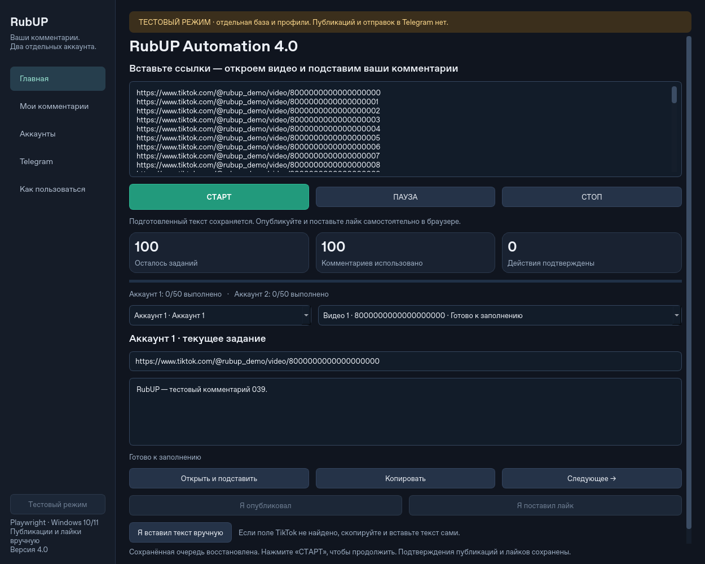

# RubUP Automation 4.0 — Windows + Playwright

**Ваши комментарии, два отдельных профиля TikTok и сохранённая очередь.**

**50 ссылок → «СТАРТ» → Playwright открывает видео и подставляет ваш текст →
вы публикуете комментарий и ставите ему лайк в браузере → подтверждаете действия
в приложении → после завершения обоих аккаунтов ссылка уходит в Telegram.**

В версии 4.0 нет генерации нейросетью, поля OpenAI API-ключа или расходов на ИИ.
Тексты берутся только из вашего банка. Программа открывает страницу и заполняет
поле; кнопки публикации и лайков нажимаете вы. CAPTCHA, ограничения входа и другие
проверки TikTok проходите самостоятельно на официальном сайте.



## Установка на Windows 10/11

1. Установите **Python 3.12, 64-bit** с [python.org](https://www.python.org/downloads/windows/).
   В установщике оставьте Python Launcher и отметьте **Add python.exe to PATH**.
2. Полностью распакуйте ZIP в доступную для записи папку, например
   `C:\Мои программы\RubUP`. Не запускайте приложение прямо из ZIP.
3. Откройте **`install.bat`** двойным нажатием. Он создаст `.venv`, установит
   зависимости и **Chromium для Playwright**. При первой установке нужна сеть;
   загрузка браузера может занять несколько минут.
4. После сообщения об успешной установке откройте **`start.bat`**.
   В дальнейшем запускайте программу этой кнопкой.

Установка не заменяет настройки, базу, пользовательские изображения или сессии.
Если Chromium не установился либо после обновления Playwright нужна новая версия
браузера, закройте приложение и запустите **`install_chromium.bat`**.
Используется отдельный Chromium Playwright; установленный Chrome его не заменяет.
Пути с пробелами и русскими буквами поддерживаются сценариями установки.

## Сначала добавьте свои комментарии

В разделе **«Мои комментарии»** вставьте тексты, каждый с новой строки,
и сохраните их. За один импорт принимается до **500 строк**; для пробы достаточно
нескольких. На 50 новых видео для двух аккаунтов потребуется **100 свободных текстов**.

Каждый текст должен содержать название **RubUP**. Пустые строки пропускаются,
некорректные строки объясняются в результате импорта. Одинаковые тексты с разным
регистром или лишними пробелами не добавляются повторно. Один комментарий может
содержать до 1000 символов; фактический лимит поля TikTok может быть ниже.

Распределение случайное. Каждый текст закрепляется за одной задачей и больше не
выбирается, в том числе после перезапуска. Два аккаунта на одном видео получают
разные комментарии. Если свободных текстов недостаточно, добавьте ещё и продолжите
очередь; уже назначенные тексты сохраняются.

**«Сбросить историю использования»** разрешает повторное использование комментариев
завершённых задач для новых видео. Это явное действие с подтверждением. Незавершённые
назначения сохраняются; один текст не назначается обоим аккаунтам одного видео
даже после сброса. Сброс не удаляет публикации и не запускает их повторно.
Счётчик использованных текстов включает закреплённые за задачами, даже если они
ещё не опубликованы.

## Подключите два аккаунта

1. Откройте раздел **«Аккаунты»**, задайте понятные названия двух аккаунтов.
2. Откройте вход первого аккаунта. Playwright запустит официальный TikTok
   в отдельном окне Chromium. Войдите вручную привычным способом.
3. Повторите вход для второго аккаунта. Его окно использует другую папку профиля.
4. Перед публикацией проверьте в самом TikTok, что открыт нужный аккаунт.

Пароли приложение не спрашивает. Само по себе название аккаунта не подтверждает
успешный вход. Сессии хранятся локально в отдельных папках
`data/playwright_profiles/account-1` и `account-2`. Они не синхронизируются и не
включаются в ZIP. Не передавайте эти папки другим людям: в них содержится сессия.
Очередь и статистика у каждого аккаунта свои. Переименование профиля сохраняет его
постоянный ID, историю и назначения.

## Обработка ссылок

1. На **«Главной»** вставьте ссылки — одна на строку, до 100 за раз.
2. Нажмите **«СТАРТ»**. Полные адреса проверяются локально. Короткие `vt.tiktok.com`
   и `vm.tiktok.com` раскрываются через допустимые перенаправления, если сайт доступен.
   Дубликаты видео исключаются, задания для двух аккаунтов сохраняются в SQLite.
3. Выберите аккаунт. Программа откроет его очередное видео и попробует заполнить
   поле комментирования уже назначенным текстом. Она не нажимает «Опубликовать».
4. Прочитайте текст, **опубликуйте его самостоятельно в браузере** и убедитесь,
   что комментарий появился. Затем подтвердите публикацию в приложении.
5. **Самостоятельно поставьте лайк своему комментарию в TikTok** и подтвердите это
   в приложении. Лайк видео не заменяет лайк комментария.
6. Продолжите следующие задания и выполните очередь второго аккаунта.

Публикация и лайк подтверждаются отдельно. Подтверждения — ваши локальные отметки,
а не результат скрытой проверки TikTok. Простое открытие страницы или заполнение
поля не засчитывается как публикация. После перезапуска используйте сохранённую
очередь; повторная вставка тех же ссылок не создаёт ещё два задания.

Видео с уже подтверждённой публикацией в истории 2.0/3.0 также пропускаются.
Программа сообщает их количество и не назначает новые комментарии: прежние
аккаунты нельзя надёжно сопоставить с новыми браузерными сессиями.

**«ПАУЗА»** приостанавливает переходы, **«СТОП»** отменяет текущую подготовку и
дальнейшие переходы. Уже выполненные вручную действия в браузере не отменяются.
Прогресс, назначения и подтверждения остаются в базе. Для продолжения нажмите
«СТАРТ»; не сбрасывайте историю банка ради возобновления.

Если TikTok изменил страницу, поле скрыто, комментарии отключены, нужен вход или
CAPTCHA, автоматическое заполнение может не сработать. Прочитайте сообщение,
пройдите проверку вручную и повторите открытие. Программа не обходит защиту и
не нажимает случайные элементы. При недоступной короткой ссылке откройте ролик
в обычном браузере и вставьте полный адрес вида
`https://www.tiktok.com/@username/video/1234567890123456789`.

Если поле изменилось, можно скопировать назначенный текст, вставить его вручную
в нужном аккаунте и нажать **«Я вставил текст вручную»**. Эта отметка подтверждает
только вставку; публикация и лайк по-прежнему подтверждаются отдельно.
Кнопка **«Тестовый режим»** открывает отдельное окно с 50 тестовыми видео и
100 комментариями, сохраняя рабочую очередь. Оно не открывает настоящий TikTok
и не отправляет сообщения в Telegram.

## Telegram: только URL после выполнения обоих аккаунтов

В разделе **«Telegram»** укажите **токен бота**, **Chat ID**, включите отправку
и сохраните настройки. Ключей других сервисов не требуется.

- Создайте своего бота через **@BotFather** (`/newbot`) и скопируйте токен.
- Откройте диалог со своим ботом и нажмите **Start**. Для группы добавьте бота
  и предоставьте ему право отправки сообщений.
- Укажите Chat ID нужного личного чата или группы. Отрицательный ID группы допустим.
  Получение Chat ID через официальный `getUpdates` описано во встроенной инструкции.

Ссылка отправляется после подтверждённых публикации **и лайка комментария для обоих
аккаунтов**. Сообщение содержит только прямой URL ролика, без подписи и текста
комментария. История отправки общая с прежней версией и защищает от дублей.

При явном отказе Telegram можно устранить причину и повторить доставку. Если сеть
оборвалась и результат неизвестен, повтор блокируется, чтобы не прислать дубликат:
проверьте чат вручную. Отметка «неизвестно» не означает успешную доставку.
Не включайте подробные HTTP-логи: токен Telegram входит в адрес API-запроса.

На Windows настройки подключения защищаются **DPAPI текущего пользователя**
в `data/credentials.dpapi`. На Linux применяется локальный `.env` с доступом владельцу.
Существующие настройки других сервисов сохраняются при обновлении, но версия 4.0
их не использует. Ключи не нужно добавлять в GitHub или присылать в чат.

## Тестовый режим и сохранение данных

Встроенная инструкция находится в разделе **«Как пользоваться»**. Для изолированной
демонстрации 50 видео и 100 назначений разработчик может запустить
`python main.py --batch-demo`; она не обращается к реальному TikTok или Telegram.
Тестовые данные не выдаются за реальные публикации. Основной интерфейс также
сообщает о тестовом режиме, когда приложение запущено в нём.

Новые таблицы добавляются к существующей SQLite-базе. Перед первой миграцией 4.0
создаётся согласованная резервная копия; при ошибке копирования миграция не продолжается.
Старые записи, пользовательские настройки и изображения сохраняются. Профили
Playwright 4.0 создаются отдельно: ранее используемые профили Chrome/Edge не копируются.

Перед обновлением закройте приложение и сохраните в защищённом месте `data`, `images`,
`config.yaml` и `.env`, если он есть. Не заменяйте свой `config.yaml` шаблоном из ZIP.
Копируйте обновлённые исходники и папки программы, оставляя данные на месте, затем
повторите `install.bat`. Активную SQLite-базу во время записи не копируйте одним файлом.
Локальные журналы находятся в `logs`; сессии и личные данные в выпуск не включаются.

Версия 2.0 остаётся в [`backup-v2`](https://github.com/deakatsuxq/RubUP-TikTok-Automation/tree/backup-v2),
состояние перед обновлением 4.0 — в [`backup-v3`](https://github.com/deakatsuxq/RubUP-TikTok-Automation/tree/backup-v3).
Новая разработка выполняется в [`rubup-v4`](https://github.com/deakatsuxq/RubUP-TikTok-Automation/tree/rubup-v4).
Исторические исходники `legacy_v3` нужны только для сохранённых регрессионных тестов.
В рабочее приложение и сборку EXE они не подключаются. В документации `docs/v2.md`
и `docs/v3.md` описаны прежние версии; актуальная инструкция — этот README и
[docs/v4.md](docs/v4.md).

## Сборка EXE на Windows

После `install.bat` запустите в PowerShell:

```powershell
powershell -NoProfile -ExecutionPolicy Bypass -File .\build_windows.ps1
```

Создаётся **новая** папка
`dist\RubUP-Automation-4.0-<дата-время>\RubUP-Automation` с `RubUP-Automation.exe`.
Сборка не заменяет установленную программу и не копирует базы, ключи, сессии или
пользовательские изображения. Передавайте **всю папку**, включая `_internal`.

На другом компьютере перед первым запуском EXE откройте находящийся рядом
**`install_chromium.bat`**. Он устанавливает соответствующий Chromium в кэш текущего
пользователя Windows через встроенный драйвер Playwright; Python для этой операции
не требуется. Сам Chromium в папку EXE не включается. При обновлении Playwright
повторите установку Chromium. Драйвер упаковывается через `--collect-all playwright`.

Сборка и запуск EXE требуют отдельной проверки на Windows 10/11. В Linux проверяются
исходники, тесты и архив; это не проверенный готовый Windows EXE. Программа не подписана.

## Команды для разработчика

```powershell
py -3.12 -m venv .venv
.\.venv\Scripts\python.exe -m pip install -r requirements.txt
.\.venv\Scripts\python.exe -m playwright install chromium
.\.venv\Scripts\python.exe main.py
.\.venv\Scripts\python.exe main.py --batch-demo
.\.venv\Scripts\python.exe -m pytest -q
.\.venv\Scripts\python.exe tools\package_project.py
```

Для Linux без дисплея используйте `QT_QPA_PLATFORM=offscreen`. Браузерные тесты
работают с локальными тестовыми HTML-страницами и отдельными временными профилями;
настоящих публикаций, лайков и сообщений они не выполняют. При отсутствии Chromium
соответствующие проверки сообщают о пропуске, а не о пройденном браузерном тесте.
Итоги проверки: [docs/validation.md](docs/validation.md).

ZIP создаётся рядом с проектом: **`RubUP-Automation-4.0-Windows.zip`**. Это исходники,
сценарии Windows, тесты, документация и `SHA256SUMS.txt`. В архив не входят `.env`,
DPAPI, базы, логи, браузерные профили, окружение Python или старые ZIP. Предыдущие
архивы сохраняются. Целевой ZIP заменяется только после успешной проверки нового.
Номер выпуска берётся из файла `VERSION`. В ZIP и EXE кладётся чистый `config.yaml`
из `config.v4.example.yaml`, а не настройки рабочего checkout. Прежние поля модели
и стоимости в вашей существующей конфигурации допустимы для совместимости, но
сценарий 4.0 их не использует. При обновлении не заменяйте свой файл шаблоном.
